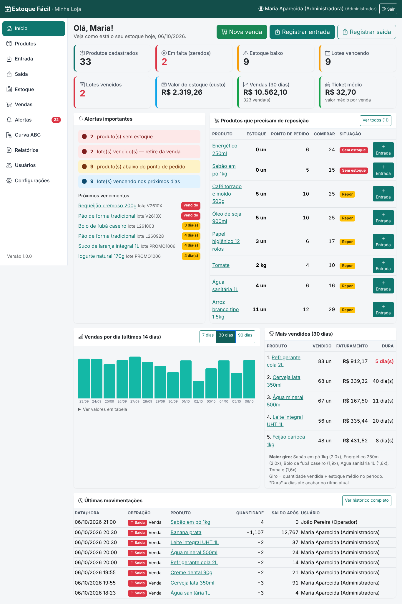

# Estoque Fácil — Gestão de estoque para pequenos comércios

Sistema web de controle de estoque desenvolvido em **Python (Flask)** para pequenos comércios
— mercearias, padarias e lojas de conveniência de **Barueri-SP** — como implementação do projeto
extensionista **"Desenvolvendo App de Gestão para Pequenos Negócios"** (UNINTER, Bacharelado em
Ciência da Computação, Atividade Extensionista III).



## Objetivo e contexto

Pequenos comerciantes costumam controlar o estoque "de cabeça", em cadernos ou planilhas. Isso causa
falta de produtos, perdas por vencimento e compras feitas sem informação. O Estoque Fácil oferece
um controle **simples, em português claro e sem treinamento extenso**, alinhado aos ODS:

- **ODS 8 — Trabalho decente e crescimento econômico:** mais controle e menos perdas para o pequeno negócio;
- **ODS 10 — Redução das desigualdades:** tecnologia gratuita e acessível para quem não tem acesso a ERPs.

## Funcionalidades

| Área | O que faz |
|---|---|
| **Início (painel)** | Total de produtos, em falta, estoque baixo, lotes vencendo/vencidos, valor do estoque, vendas e ticket médio do período, gráfico de vendas, mais vendidos (com "dura X dias"), maior giro, alertas e últimas movimentações |
| **Produtos** | Cadastro, edição, visualização, exclusão (com confirmação), pesquisa e filtros; categorias; código/SKU e código de barras únicos |
| **Entrada / Saída** | Compra, devolução, ajuste, perda, consumo etc.; saldo atualizado na hora; **saída maior que o estoque é bloqueada** |
| **Lote, validade e nº de série** | Opcionais por produto; saída automática pelo lote que vence primeiro (FEFO); **lote vencido não pode ser vendido**; histórico por lote e por número de série |
| **Alertas** | Sem estoque, ponto de pedido atingido (com sugestão de compra = máximo − atual), vencidos, vencendo em até 7/30 dias (configurável) |
| **Vendas** | Venda com vários itens, leitor de código de barras, forma de pagamento; tudo-ou-nada (se faltar um item, nada é baixado) |
| **Curva ABC** | Classificação A/B/C pelo faturamento, com participação e acumulado; limites configuráveis |
| **Relatórios** | Estoque, movimentações (período/produto/tipo/usuário), vendas, validade e Curva ABC — com exportação **CSV** e impressão |
| **Usuários e perfis** | Administrador e Operador; senha com hash; auditoria de quem fez cada movimentação |
| **Configurações** | Nome da loja, janelas de validade, limites e período da Curva ABC |

## Tecnologias

- Python 3.11+ · Flask 3 · Flask-SQLAlchemy (SQLAlchemy 2) · Flask-Login · Flask-WTF (CSRF) · Flask-Migrate (Alembic)
- SQLite (padrão) — preparado para PostgreSQL via `DATABASE_URL`
- HTML5, CSS3, JavaScript puro e Bootstrap 5 **embutido no projeto** (funciona sem internet)
- pytest + pytest-cov; Playwright (opcional, para screenshots e teste no navegador)

## Instalação e execução

Pré-requisito: Python 3.11 ou superior.

```bash
git clone <url-do-repositorio> && cd GerenciadorDeEstoque
python -m venv .venv
# Windows: .venv\Scripts\activate    |   Linux/macOS: source .venv/bin/activate
pip install -r requirements.txt
cp .env.example .env            # opcional: ajuste SECRET_KEY / DATABASE_URL

python -m seed.seed             # (opcional) carrega dados de demonstração
python run.py                   # abre em http://localhost:5000
```

Na primeira execução, `run.py` cria o banco automaticamente (migrations) e, se não houver usuários,
cria o administrador padrão. Para acessar de um celular/tablet na mesma rede Wi-Fi, use
`HOST=0.0.0.0 python run.py` e abra `http://<ip-do-computador>:5000`.

### Credenciais de demonstração (somente desenvolvimento)

| Perfil | E-mail | Senha |
|---|---|---|
| Administrador | `admin@estoque.local` | `admin123` |
| Operador | `operador@estoque.local` | `operador123` |

> Troque essas senhas em **Usuários** antes de qualquer uso real.

### Comandos úteis

```bash
flask --app run seed               # recria os dados de demonstração
flask --app run criar-admin        # cria um administrador
flask --app run verificar-saldos   # confere saldo de cada produto x histórico de movimentações
flask --app run db upgrade         # aplica migrations (evolução do banco)
```

## Testes

```bash
python -m pytest                       # todos os testes
python -m pytest --cov=app             # com cobertura
python scripts/metricas.py             # gera docs/METRICAS.md
# Com o sistema rodando e o Playwright instalado (pip install playwright && playwright install chromium):
python scripts/teste_aceitacao_navegador.py http://127.0.0.1:5000
python scripts/capturar_telas.py http://127.0.0.1:5000
```

Resultados atuais: ver [docs/TESTES.md](docs/TESTES.md) e [docs/METRICAS.md](docs/METRICAS.md).

## Estrutura

```
app/
├── __init__.py          # fábrica da aplicação, tratamento de erros, comandos CLI
├── config.py            # configurações + parâmetros de negócio centralizados
├── models/              # tabelas (SQLAlchemy)
├── services/            # REGRAS DE NEGÓCIO (estoque, alertas, vendas, ABC, relatórios)
├── routes/              # telas (blueprints Flask) — só chamam os serviços
├── templates/           # páginas HTML (Jinja2)
├── static/              # CSS/JS próprios + Bootstrap embutido
└── utils/               # formatação BR, conversão de valores, permissões, CSV
migrations/              # evolução do banco (Alembic)
seed/                    # dados de demonstração
tests/                   # testes automatizados (pytest)
scripts/                 # métricas, screenshots, teste no navegador
docs/                    # documentação técnica e acadêmica
run.py                   # ponto de entrada
```

## Documentação

- [Matriz de rastreabilidade (requisito → implementação → teste)](docs/MATRIZ_RASTREABILIDADE.md)
- [Arquitetura, banco de dados e diagramas](docs/ARQUITETURA.md)
- [Roteiro de teste manual de aceitação](docs/ROTEIRO_TESTE_MANUAL.md)
- [Evidências de testes](docs/TESTES.md) · [Métricas](docs/METRICAS.md) · [Validação por cenários](docs/VALIDACAO_CENARIOS.md)
- [Relatório acadêmico: metodologia, resultados e considerações finais](docs/RELATORIO_ACADEMICO.md)
- [Screenshots](docs/screenshots/)

## Limitações conhecidas

- Não emite documentos fiscais (NF-e/NFC-e/cupom) e não integra com maquininhas ou bancos — está fora do escopo.
- Alertas são exibidos no sistema; **não há envio de e-mail** (item desejável P2 não implementado).
- O SQLite atende bem um comércio com poucos usuários simultâneos. Para várias lojas ou muitos acessos
  simultâneos, recomenda-se PostgreSQL (`DATABASE_URL`) e um servidor WSGI (ex.: `waitress`/`gunicorn`).
- A disponibilidade de 99,9% (RNF-002) depende da hospedagem; o projeto entrega a aplicação pronta para
  ser hospedada, mas não inclui infraestrutura de alta disponibilidade.
- Na venda, produtos com número de série têm as unidades escolhidas automaticamente (as mais antigas);
  para escolher a unidade exata, use **Saída** com o tipo "Venda".
- Não há recuperação de senha por e-mail: o administrador redefine a senha em **Usuários**.

## Autor

Pietro Rantin Venâncio — RU 4739736 — UNINTER, Bacharelado em Ciência da Computação.
