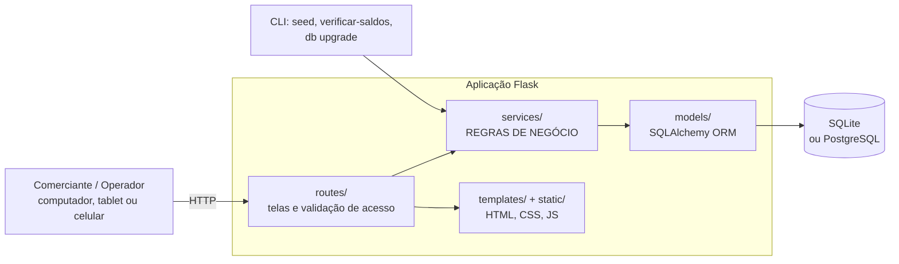
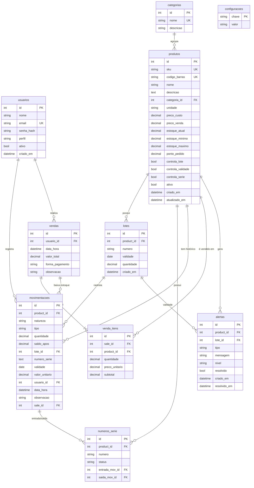
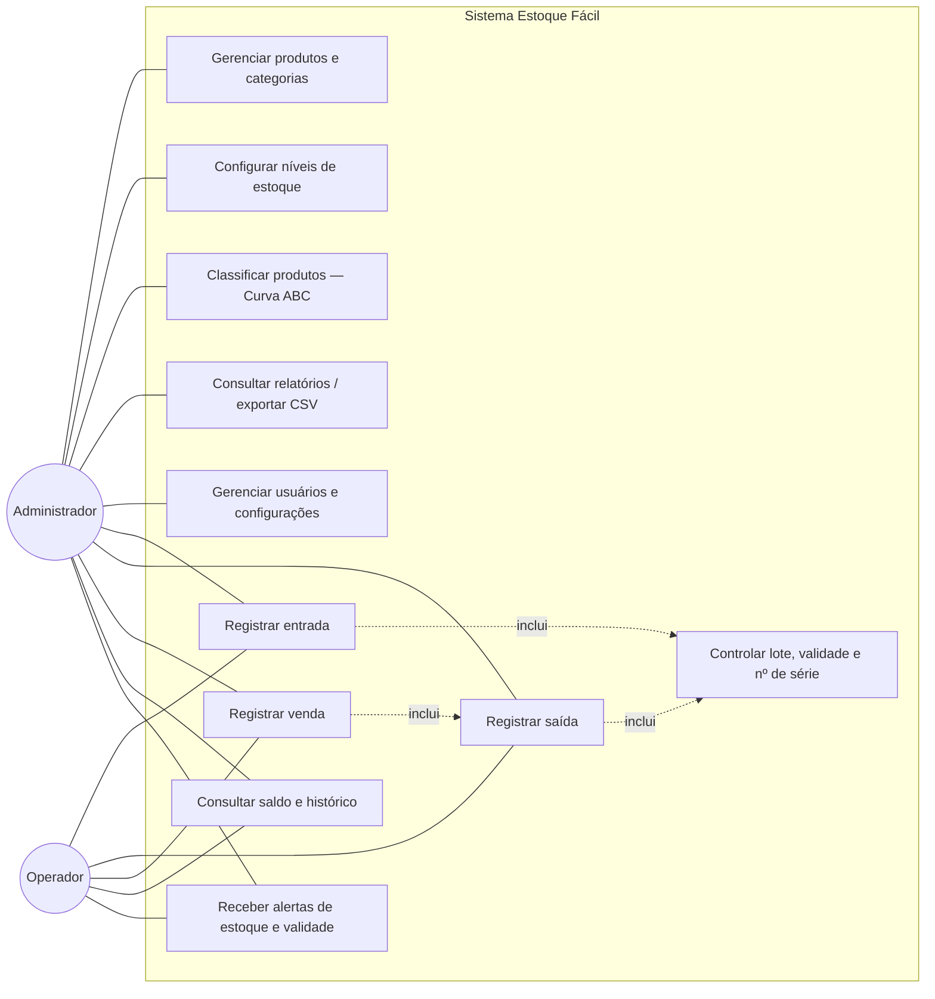
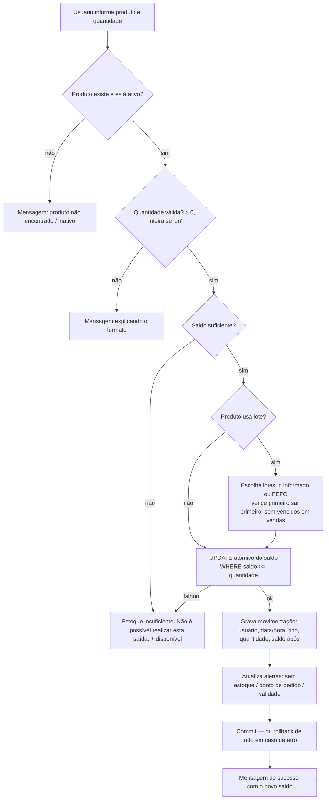
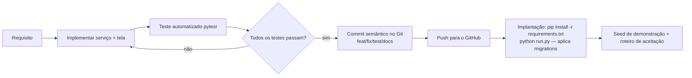

# Arquitetura e banco de dados

## Visão geral

Aplicação web monolítica em camadas — escolhida por ser simples de instalar (um único processo
Python + um arquivo SQLite), adequada a um pequeno comércio e fácil de manter.

| Camada | Responsabilidade | Não faz |
|---|---|---|
| `routes/` | Recebe a requisição, verifica login/perfil, chama o serviço, mostra mensagem | Não calcula estoque |
| `services/` | Todas as regras: saldo, bloqueio, lotes (FEFO), alertas, vendas, Curva ABC, relatórios | Não conhece HTML |
| `models/` | Estrutura das tabelas e propriedades de leitura (situação, sugestão de compra) | Não altera saldo |
| `templates/`, `static/` | Apresentação e conforto de uso (busca, máscara, avisos) | Não decide regras — o servidor sempre revalida |

**Regra central:** somente `services/inventory_service.py` altera saldos. Entrada, saída e venda
chamam as mesmas funções (`registrar_entrada`, `registrar_saida`), evitando regras duplicadas.

## Decisões técnicas

| Decisão | Motivo |
|---|---|
| Flask (e não FastAPI/SPA) | Menos código e menos dependências para entregar telas HTML rapidamente |
| Bootstrap embutido em `static/vendor` | Funciona sem internet — comum em pequenos comércios |
| Gráficos em HTML/CSS (sem biblioteca JS) | Leves, acessíveis (tabela de valores junto) e offline |
| Saldo em `produtos.estoque_atual` alterado por `UPDATE ... SET estoque = estoque - q WHERE estoque >= q` | Consulta instantânea (RNF-001) e impossibilidade de saldo negativo mesmo com dois usuários simultâneos |
| Movimentações imutáveis + `recalcular_saldo` | Auditoria (RNF-005) e prova de integridade (comando `verificar-saldos`) |
| Alertas persistidos e resolvidos automaticamente | Histórico de quando o problema surgiu e quando foi resolvido |
| Parâmetros de negócio em `config.DEFAULT_SETTINGS` + tabela `configuracoes` | Limites ABC e janelas de validade em um único lugar, editáveis pela tela |
| Flask-Migrate (Alembic) com `render_as_batch` | Evolução do banco compatível com SQLite e PostgreSQL |
| Valores monetários `Numeric(12,2)`, quantidades `Numeric(12,3)` + `Decimal` | Evita erros de arredondamento de `float`; permite kg/litro fracionados |

## Modelo entidade-relacionamento

Índices relevantes: `produtos.sku`, `produtos.codigo_barras`, `produtos.nome`, `movimentacoes(product_id, data_hora)`,
`movimentacoes(data_hora)`, `lotes.validade`, `vendas.data_hora`, `alertas(resolvido, tipo)`.

## Casos de uso

Baseado no diagrama da proposta, detalhado por perfil:

## Fluxo de uma saída de estoque (venda, perda, consumo...)

## Fluxo de desenvolvimento e implantação

## Segurança

- Senhas com hash (`werkzeug.security`, PBKDF2/scrypt); usuário desativado não entra.
- Sessão com expiração (8 h), cookies `HttpOnly`/`SameSite=Lax`; logout via POST.
- Proteção CSRF em todos os formulários (Flask-WTF).
- Controle de acesso por perfil (`@admin_required`); operador recebe 403 nas áreas administrativas.
- Redirecionamento pós-login só para URLs internas (evita *open redirect*).
- Consultas via ORM (sem SQL concatenado) — proteção contra SQL injection; Jinja2 escapa HTML (XSS).
- Erros internos registrados em log e exibidos ao usuário como mensagem amigável.
