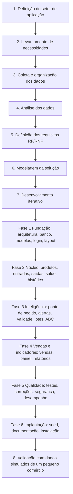

# Subsídios para o Relatório Final — Atividade Extensionista III

> Material de apoio para preencher as seções **Metodologia**, **Resultados Esperados/Obtidos** e
> **Considerações Finais** do relatório. Os números vêm do próprio projeto
> ([METRICAS.md](METRICAS.md), [TESTES.md](TESTES.md)) e podem ser regenerados a qualquer momento.

**Aluno:** Pietro Rantin Venâncio — RU 4739736
**Título:** Desenvolvendo App de Gestão para Pequenos Negócios
**Setor de aplicação:** pequenos comércios locais de Barueri-SP (mercearias, padarias e lojas de conveniência)
**ODS:** 8 — Trabalho decente e crescimento econômico; 10 — Redução das desigualdades

## 1. Problema identificado

Pequenos comerciantes do setor de aplicação não possuem soluções digitais de gestão. O controle de
estoque informal provoca: falta de produtos de alta saída (venda perdida), produtos vencidos na
prateleira (prejuízo e risco ao consumidor), compras sem critério e desconhecimento de quais produtos
realmente sustentam o faturamento. Soluções de mercado (ERPs) costumam ser caras, complexas e exigem
treinamento — uma barreira tecnológica que reforça a desigualdade entre pequenos e grandes varejistas.

## 2. Solução tecnológica

O **Estoque Fácil**, aplicação web em Python (Flask) com banco relacional (SQLite/PostgreSQL), que roda
em um computador simples da loja e pode ser acessada por celular/tablet na rede local. Cobre o núcleo
obrigatório definido na proposta (RF-001 a RF-006) e os itens evoluídos do escopo: lote e validade,
número de série, vendas, Curva ABC, painel de indicadores e relatórios.

## 3. Metodologia (sequência das atividades)

A metodologia da proposta (Etapas 1 a 8) foi seguida e, na fase de implementação, detalhada em um
ciclo iterativo com controle de configuração (Git) e testes a cada módulo:

Em cada módulo da Etapa 7 aplicou-se o ciclo: **analisar requisito → implementar → executar → testar →
corrigir → documentar → commit**. Detalhamento:

| Passo | Atividade | Produto / evidência |
|---|---|---|
| 1 | Análise da proposta e do escopo; matriz requisito → funcionalidade → implementação → teste; identificação de conflitos | [MATRIZ_RASTREABILIDADE.md](MATRIZ_RASTREABILIDADE.md) |
| 2 | Arquitetura em camadas (rotas, serviços, modelos) e modelo de dados | [ARQUITETURA.md](ARQUITETURA.md), `migrations/` |
| 3 | Fundação: configuração, autenticação com hash, perfis, layout responsivo | commit `feat: implement app foundation...` |
| 4 | Núcleo de estoque centralizado em um único serviço | `app/services/inventory_service.py` |
| 5 | Alertas de reposição e validade, lotes (FEFO) e números de série | `alert_service.py`, `test_expiry.py` |
| 6 | Vendas, Curva ABC, painel e relatórios com CSV | `sales_service.py`, `abc_service.py` |
| 7 | Testes automatizados (unidade, fluxo HTTP, permissões, desempenho) | `tests/`, [TESTES.md](TESTES.md) |
| 8 | Dados simulados: 90 dias de operação de uma mercearia de Barueri (33 produtos, ~970 vendas, ~2.170 movimentações) | `seed/seed.py` |
| 9 | Validação: roteiro de aceitação de 17 passos executado em navegador real; verificação de integridade dos saldos | [ROTEIRO_TESTE_MANUAL.md](ROTEIRO_TESTE_MANUAL.md), `scripts/teste_aceitacao_navegador.py` |
| 10 | Evidências: screenshots (computador e celular), métricas, histórico de commits | `docs/screenshots/`, [METRICAS.md](METRICAS.md) |

**Controle de configuração:** repositório Git/GitHub com commits semânticos (`feat`, `fix`, `test`,
`docs`, `chore`), migrations versionadas do banco (Alembic), dependências fixadas em `requirements.txt` e
configuração por variáveis de ambiente (`.env.example`). O histórico (`git log`) registra a evolução do
projeto passo a passo.

## 4. Resultados obtidos

### 4.1 Requisitos da proposta

| Requisito | Resultado |
|---|---|
| RF-001 Cadastro de produtos | ✅ Implementado e testado |
| RF-002 Entradas e saídas | ✅ Implementado e testado (compra, devolução, ajuste, venda, perda, consumo...) |
| RF-003 Saldo em tempo real | ✅ Saldo atualizado na mesma transação da movimentação |
| RF-004 Bloqueio por saldo insuficiente | ✅ Inclusive com dois usuários simultâneos (UPDATE atômico) |
| RF-005 Mínimo, máximo, ponto de pedido | ✅ Com validação de coerência |
| RF-006 Alerta de ponto de pedido | ✅ No sistema, com sugestão de compra; e-mail não implementado |
| RNF-001 Saldo em ≤ 2 s | ✅ ~0,2 ms por consulta com 100 mil movimentações |
| RNF-002 Integridade / disponibilidade | ✅ Integridade garantida e verificável; ⚠️ disponibilidade depende da hospedagem |
| RNF-003 Altas movimentações | ✅ Testado com 100 mil movimentações |
| RNF-004 Web responsiva / coletores | ✅ Celular, tablet e computador; leitor de código de barras |
| RNF-005 Auditoria (data, hora, usuário) | ✅ Toda movimentação é registrada e imutável |

### 4.2 Qualidade (ver números atualizados em [METRICAS.md](METRICAS.md))

- Testes automatizados com `pytest` cobrindo estoque, validade, vendas, Curva ABC, autenticação, perfis,
  CSRF, telas e desempenho — **todos aprovados**, com cobertura de código de cerca de 90%.
- Roteiro de aceitação de **17 passos aprovado** em navegador real (Chromium).
- Verificação de integridade `flask verificar-saldos`: **todos os saldos conferem** com o histórico após a
  simulação de 90 dias.

### 4.3 Problemas encontrados e corrigidos durante o desenvolvimento

| # | Problema | Como foi detectado | Correção |
|---|---|---|---|
| 1 | O FEFO (vence primeiro, sai primeiro) escolhia lotes **vencidos** para vendas, o que permitiria vender produto vencido | Análise das regras ao preparar a simulação de dados | Vendas e consumo ignoram lotes vencidos; lote vencido só sai como perda/devolução/ajuste (`test_lote_vencido_nao_e_vendido`) |
| 2 | Na tela de venda no celular, preço, subtotal e botão de remover ficavam escondidos (rolagem lateral) | Screenshot da tela em 390 px de largura | Itens da venda passam a ser exibidos empilhados em telas pequenas |
| 3 | Cenário de teste da Curva ABC com expectativa incorreta (produto com 10% de faturamento após 90% acumulado é classe B, não C) | Falha do teste automatizado | Revisão da regra documentada e correção do cenário de teste |
| 4 | Produto de teste com preço de venda 0 foi recusado | Falha do teste automatizado | Confirmado que a regra (preço > 0) estava correta; teste ajustado |
| 5 | Avisos de conexões de banco não fechadas nos testes | Saída do `pytest` | Liberação explícita das conexões ao final de cada teste |
| 6 | Risco de saldo negativo com dois usuários registrando saída ao mesmo tempo | Análise de concorrência | `UPDATE ... WHERE estoque_atual >= quantidade` com verificação de linhas afetadas (`test_update_atomico...`) |

### 4.4 Aplicação no contexto social

Com os dados simulados de uma mercearia, o sistema mostrou ao comerciante, logo na primeira tela:
quais produtos estão em falta e quanto comprar de cada um, quais lotes vencem nos próximos dias (para
fazer promoção antes de perder), que um pequeno grupo de produtos (classe A) concentra cerca de 80% do
faturamento, e por quantos dias o estoque atual dos mais vendidos ainda dura. São informações que
apoiam decisões de compra e reduzem perdas — diretamente ligadas ao ODS 8. A linguagem simples, os
botões grandes, o funcionamento offline e o custo zero de licença reduzem a barreira de acesso à
tecnologia (ODS 10).

## 5. Dificuldades

- Conciliar o requisito de "saldo derivado das movimentações" com a consulta em até 2 segundos —
  resolvido com saldo controlado exclusivamente pelo serviço e verificação de integridade.
- Modelar lote, validade e número de série sem complicar a operação para quem não precisa deles
  (tornados opcionais por produto).
- Prazo curto: exigiu priorização rigorosa (P0 → P1 → P2) e a exclusão consciente do envio de e-mails.

## 6. Limitações e melhorias futuras

- Notificação por e-mail/WhatsApp dos alertas de reposição e validade.
- Pedido de compra ao fornecedor gerado a partir da lista de reposição.
- Inventário (contagem) guiado pelo celular com ajuste automático das diferenças.
- Hospedagem em nuvem com PostgreSQL, backup automático e HTTPS (para atingir o RNF-002).
- Aplicativo instalável (PWA) para uso offline no celular.
- Validação em campo com comerciantes reais de Barueri e coleta de feedback de usabilidade.

## 7. Considerações finais (rascunho)

O projeto atingiu o objetivo de implementar um protótipo funcional de gestão de estoque para pequenos
comércios, cobrindo integralmente o núcleo obrigatório definido na proposta e ampliando-o com controle
de validade, lotes, vendas, Curva ABC e indicadores. A adoção de testes automatizados, controle de versão
com commits semânticos e migrations do banco permitiu evoluir o sistema com segurança e gerar evidências
objetivas de qualidade. A validação com dados simulados de um pequeno comércio demonstrou que o sistema
responde às dores levantadas — falta de produtos, perdas por vencimento e compras sem informação — com
uma interface acessível a usuários com pouca experiência em softwares de gestão. Como próximos passos,
recomenda-se a validação com comerciantes reais do setor de aplicação e a implantação em ambiente
hospedado.
