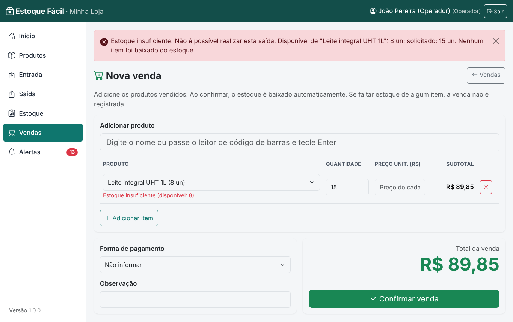
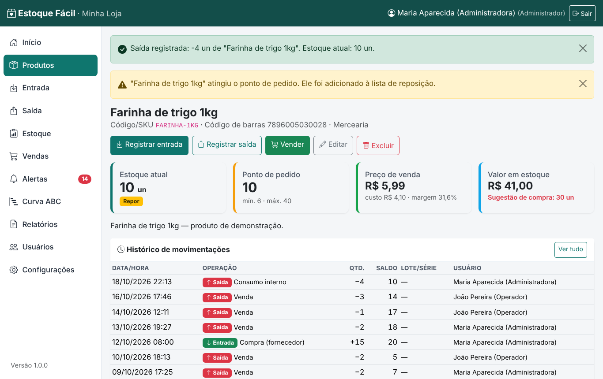
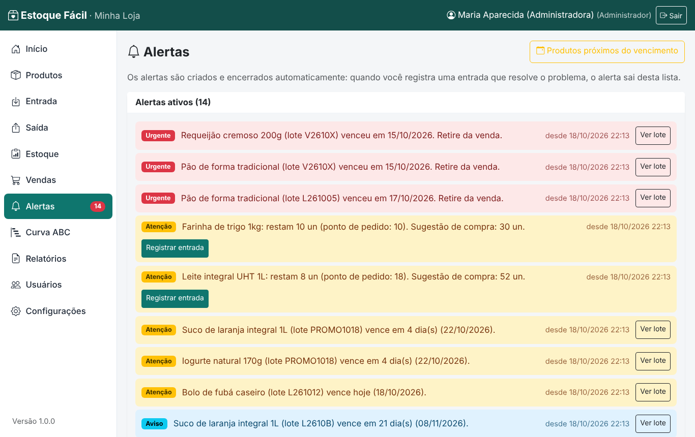
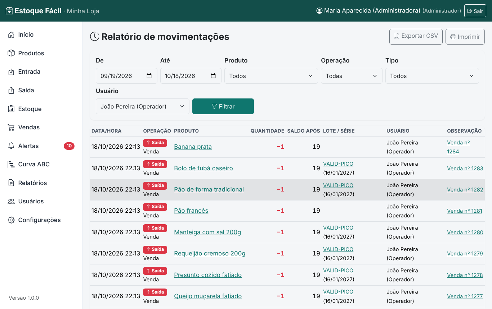
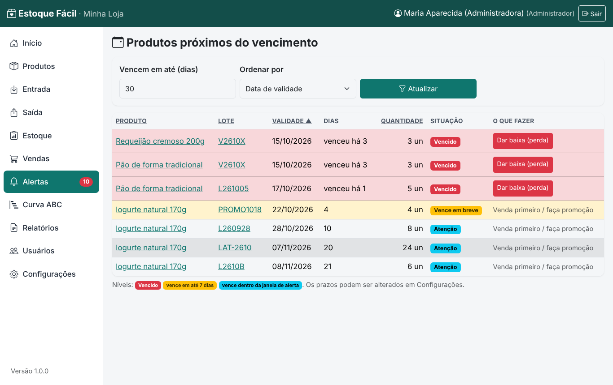
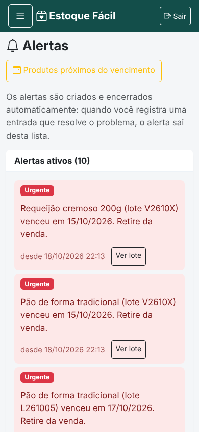

# Validação dos cenários de comércios de bairro

Executado por `scripts/validacao_cenarios.py` em 18/10/2026 22:13, no sistema real (servidor HTTP + navegador Chromium), com o banco de demonstração de uma mercearia de Barueri (90 dias simulados). Os cenários reproduzem situações típicas de mercearias, padarias e lojas de conveniência definidas no escopo do projeto.

| # | Cenário | Requisitos | Entrada | Resultado obtido | Status |
|---|---|---|---|---|---|
| 1 | Ruptura de estoque (mercearia) | RF-004, RF-003 | Venda de 15 unidades de Leite integral UHT 1L | Venda bloqueada: "Estoque insuficiente. Não é possível realizar esta saída. Disponível de "Leite integral UHT 1L": 8 un; solicitado: 15 un. Nenhum item foi baixado do estoque.". Saldo antes 8.0, depois 8.0 | Aprovado |
| 2 | Ponto de pedido (padaria) | RF-005, RF-006 | Consumo de 4 pacotes de Farinha de trigo 1kg (saldo 14, ponto de pedido 10) | Saldo 14.0 → 10.0; aviso: ""Farinha de trigo 1kg" atingiu o ponto de pedido. Ele foi adicionado à lista de reposição." e produto na lista de reposição | Aprovado |
| 3 | Pico de movimentações (conveniência) | RNF-001, RNF-003, RNF-005 | 300 vendas e 600 consultas de saldo em sequência | Consulta de saldo: média 6.1 ms, p95 7.5 ms, máx. 60.4 ms (limite 2.000 ms); 300 vendas em 7.8 s (≈ 415674 operações/h); 302 de 302 movimentações com operador, data e hora | Aprovado |
| 4 | Validade de lote (mercearia) | RF-007 | Lote LAT-2610 de Iogurte natural 170g vencendo em 20 dias (janela de 30 dias) | Lote LAT-2610 listado na tela de vencimento | Aprovado |

## Capturas

Dados brutos: [validacao/resultados.json](validacao/resultados.json).
